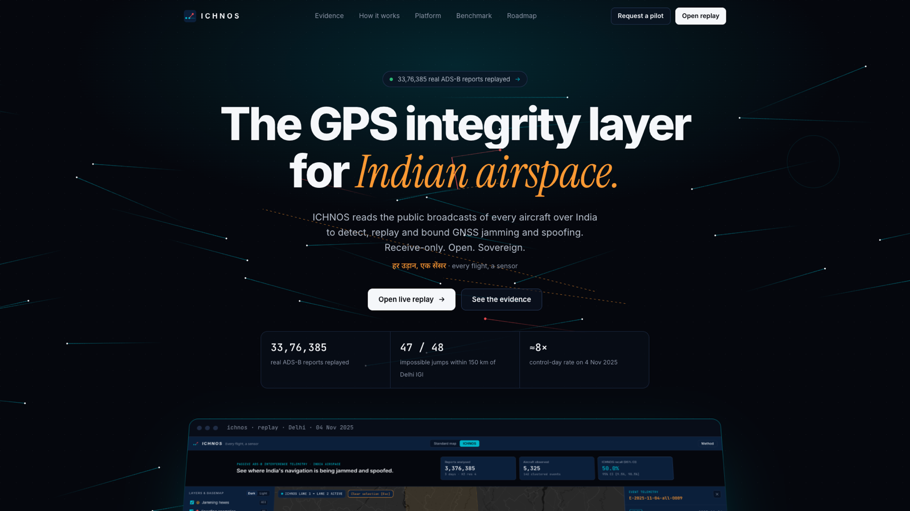
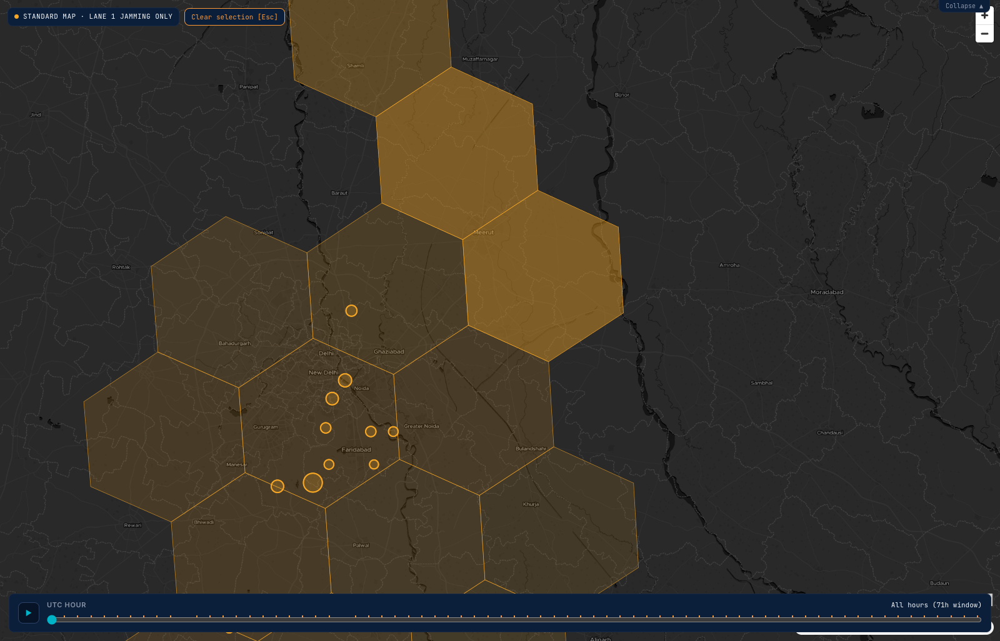
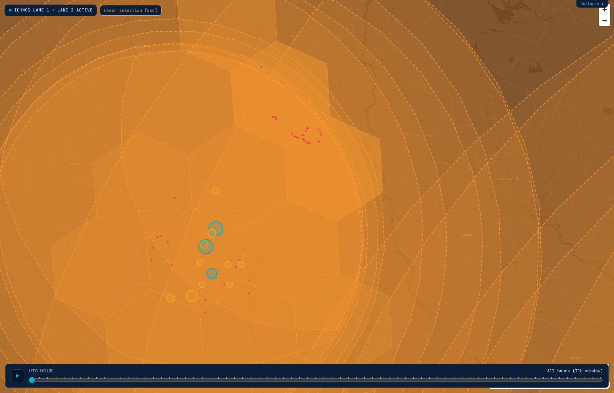
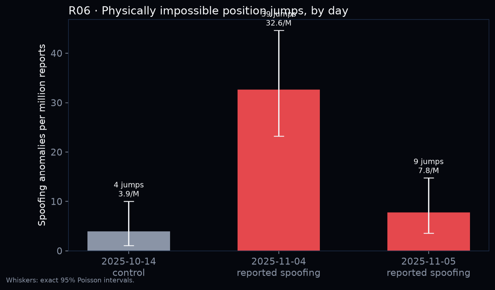
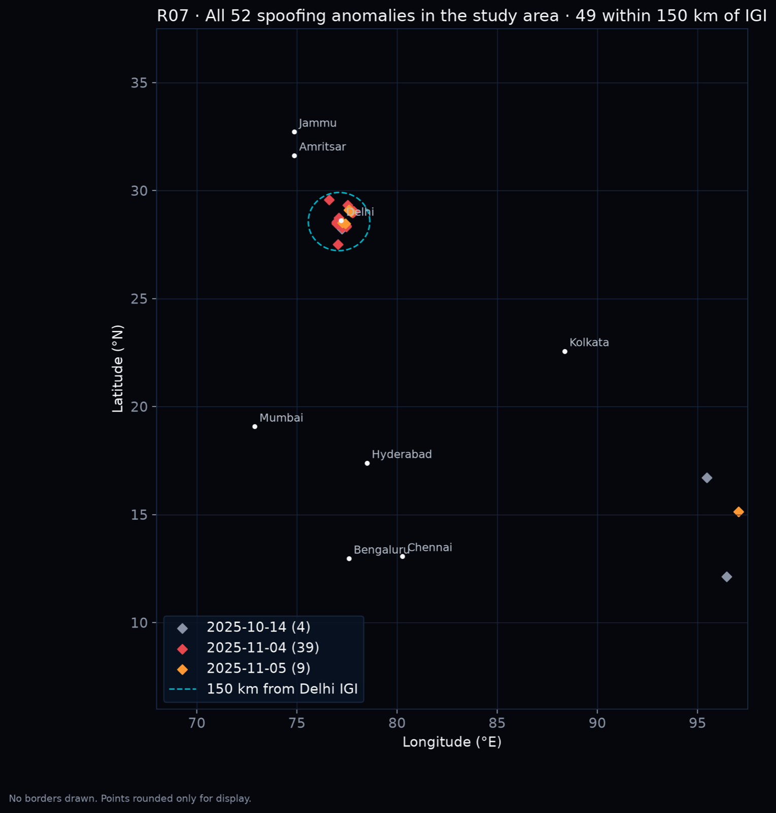
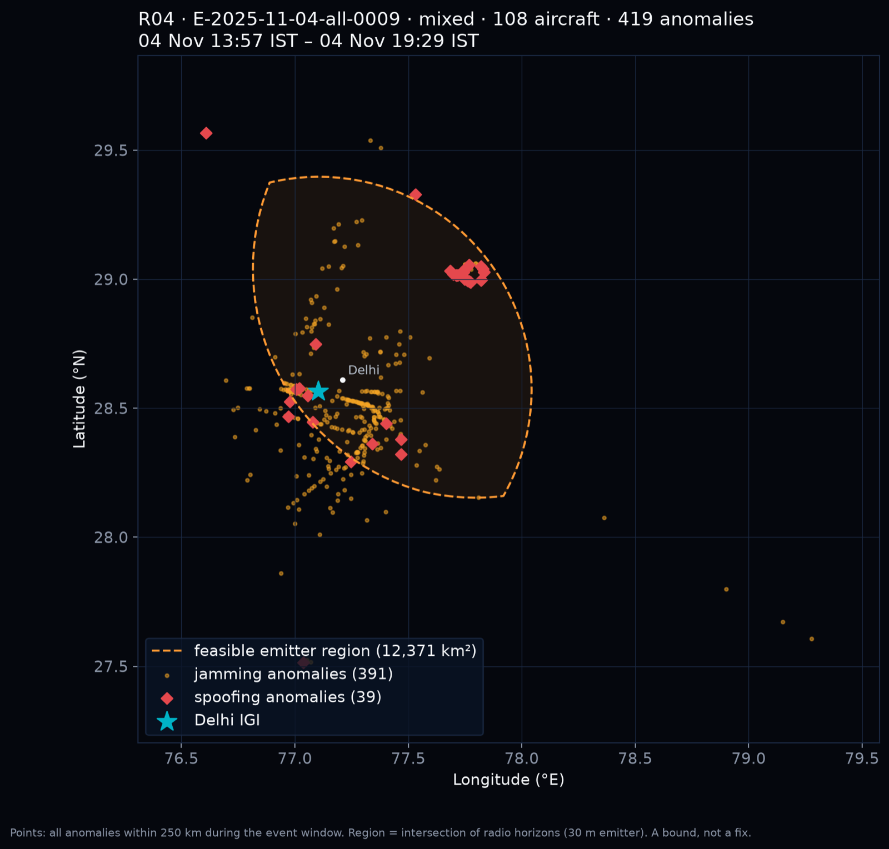
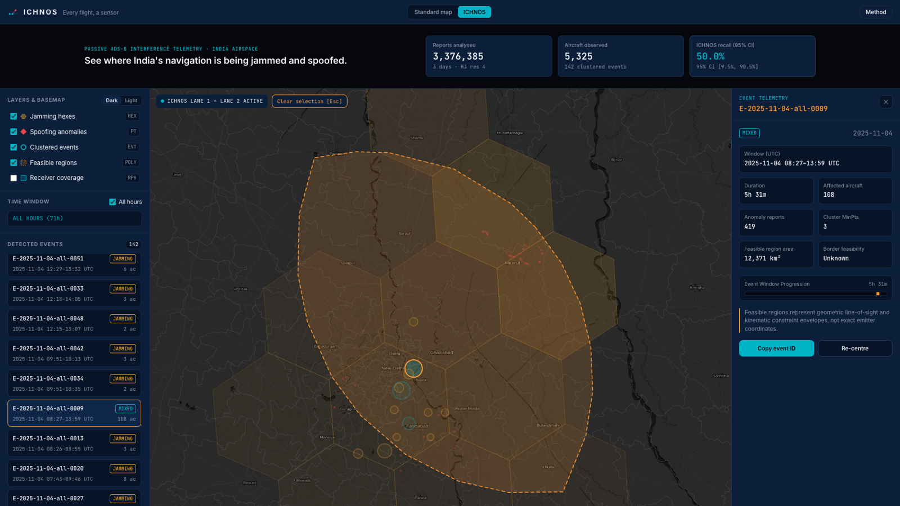
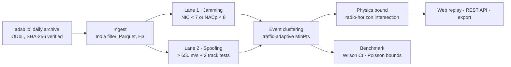
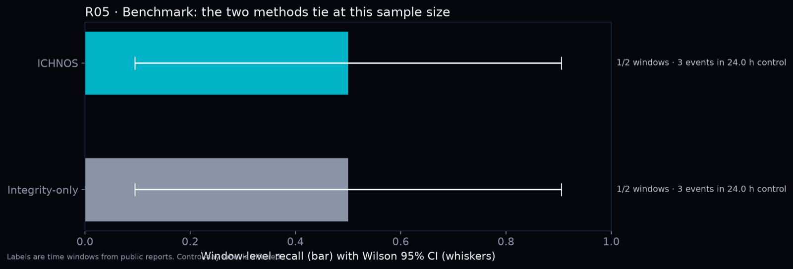
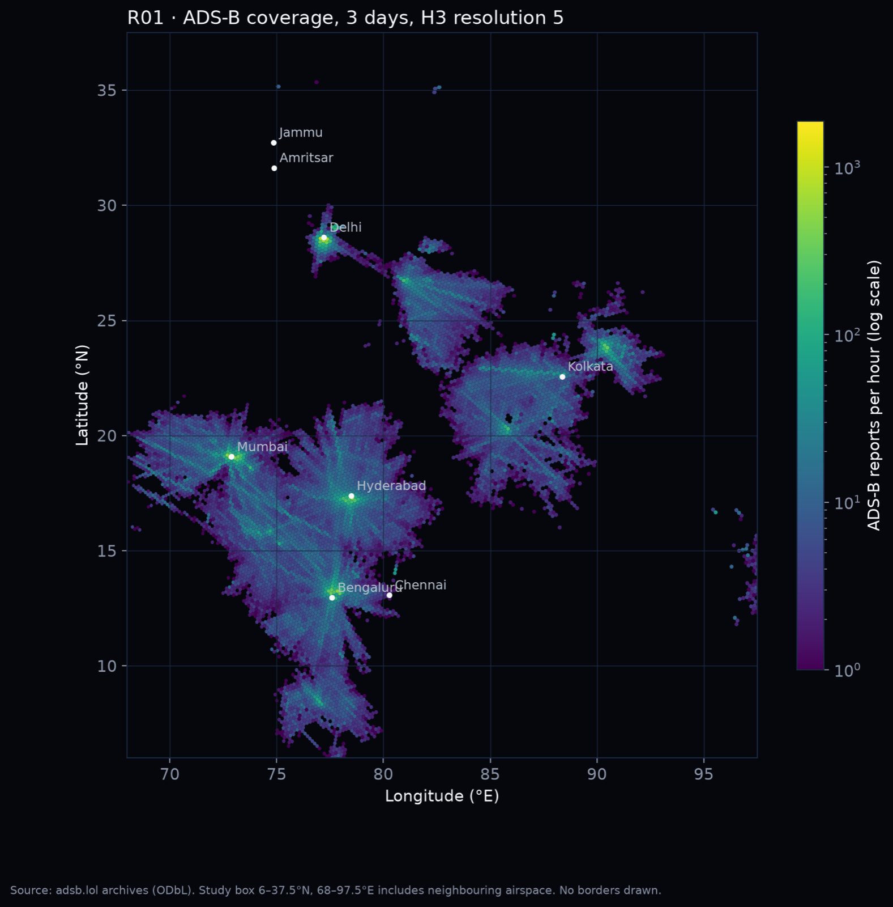

<div align="center">


# ICHNOS

**The GPS integrity layer for Indian airspace.**
Open, replayable GNSS jamming and spoofing intelligence, built from the public ADS-B broadcasts of aircraft.

*हर उड़ान, एक सेंसर · Every flight, a sensor*

[](https://ichnos-vylk.vercel.app)
[](https://github.com/TheNandinee/ichnos/actions/workflows/ci.yml)
[](LICENSE)
[](DATA_LICENSE.md)


[**Live replay**](https://ichnos-vylk.vercel.app/app) · [Landing page](https://ichnos-vylk.vercel.app) · [Findings](#key-findings) · [Quick start](#quick-start) · [How it works](#how-it-works) · [Limits](#honest-limits)



</div>

---

## Why this exists

India's Government has reported **2,354 airline-reported GNSS interference events** between November 2023 and December 2025. That includes about **465 near Amritsar and Jammu** and **623 around Delhi in January–February 2026 alone**. In November 2025, flights approaching Delhi's runway 10 were **spoofed**, and seven were diverted in a single night. DGCA now requires reports within **10 minutes**.

Yet there is no open, replayable picture of **where** this happens, or **whether it is jamming or spoofing**. Free global maps cover India poorly, and they rely on each aircraft's own integrity value. Spoofing can keep that value healthy.

ICHNOS fills the gap using data that already exists. Every airliner broadcasts its GPS-derived position about once a second, and those broadcasts are public and openly archived.

## Key findings

Three full days of real data: **14 Oct 2025** (control), and **4–5 Nov 2025** (the reported Delhi spoofing).

| | Result |
|---|---|
| Data replayed | **3,376,385** ADS-B reports over India · **5,325** aircraft-days · **142** events |
| Where the impossible jumps are | **47 of the 48** spoofing anomalies in India on 4–5 Nov were **within 150 km of Delhi IGI** |
| Rate versus control day | **32.6 vs 3.9** per million reports on 4 Nov, **≈ 8×** the control day |
| Largest Delhi event | `E-2025-11-04-all-0009`: **108 aircraft**, 5 h 31 min (13:57–19:29 IST). The spoofing lane re-labels it from *jamming* to ***mixed*** (419 vs 382 anomalies) |
| Source bound | Feasible emitter region of **12,371 km²** (≈ 63 km radius). A search area, not a location fix |
| Speed | A full 3.4 GB global day is processed and filtered to India in **2.0–3.3 min** on a laptop |

### Standard map vs ICHNOS (Delhi, 4 Nov 2025)

| Integrity-only (standard) | ICHNOS (spoofing lane on) |
|---|---|
|  |  |

| Impossible jumps by day | Where they occurred |
|---|---|
|  |  |

<details>
<summary><b>Event 0009, its feasible region, and the replay console</b></summary>




</details>

## How it works



1. **Listen.** Download a daily adsb.lol release, verify its byte count and SHA-256, and keep airborne reports over India.
2. **Detect, in two lanes.**
   - **Jamming:** integrity drops (NIC < 7, NACp < 8), mapped per H3 cell.
   - **Spoofing:** implied speed above 650 m/s **and** two adaptive track-consistency tests: a neighbour-interpolation residual and a predecessor gap.
3. **Cluster.** Space–time DBSCAN (35 km, 75 min), needing at least 2 aircraft, with a Poisson minimum that rises over busy airports.
4. **Bound.** A ground transmitter must be within the radio horizon of every affected aircraft: `d ≈ 4.12(√h_tx + √h_rx)` km. ICHNOS reports the intersection as a feasible region.
5. **Prove.** Results are scored against dated, cited incident windows and control days (`benchmarks/labels.yaml`), with confidence intervals.

## Quick start

Requires Python 3.11+, Node 20+, about 10 GB of free disk per archive day (or fewer if you use `--delete-raw`), and an internet connection for the download.

```bash
git clone https://github.com/TheNandinee/ichnos.git && cd ichnos
python -m venv .venv && source .venv/bin/activate
pip install -r requirements.txt && pip install -e .
pytest -q                                   # 7 tests

python -m ichnos.cli releases --month 2025-11
python -m ichnos.cli run --days 2025-11-04 2025-11-05 2025-10-14 --delete-raw
python -m ichnos.cli bench                  # writes metrics.json
python -m ichnos.cli export                 # writes web/public/data/*

cd web
echo "VITE_MAPTILER_KEY=your_key" > .env    # free key at cloud.maptiler.com
npm install && npm run dev                  # http://localhost:5173
```

### CLI reference

| Command | What it does |
|---|---|
| `releases --month YYYY-MM` | List adsb.lol release tags for that month |
| `download --day YYYY-MM-DD` | Download one day, resuming interrupted downloads and verifying it |
| `peek --day YYYY-MM-DD` | Print the raw trace format of one aircraft |
| `run --days D1 D2 … [--delete-raw]` | Download, ingest, detect and cluster each day |
| `bench` | Window-level recall, Wilson CI and false-alarm bound → `metrics.json` |
| `export` | Coarse public dataset for the web map (H3 res 4, no aircraft IDs) |
| `serve --port 8000` | FastAPI server for `/api/meta`, `/api/metrics`, `/api/events/{id}` |

### API (self-hosted)

```bash
curl localhost:8000/api/events/E-2025-11-04-all-0009
```

```json
{ "type": "Feature",
  "properties": { "event_id": "E-2025-11-04-all-0009", "type": "mixed",
                  "n_aircraft": 108, "n_anomalies": 419, "region_area_km2": 12371 } }
```

### Docker (offline / air-gapped)

```bash
cd web && npm run build && cd ..
docker compose up --build                   # app + API on http://localhost:8000
```

## Benchmark



| Method | Window recall (95% CI) | Control events | 95% false-alarm bound |
|---|---|---|---|
| Integrity-only | 1/2 (9.5–90.5%) | 3 in 24 h | 0.32 / h |
| ICHNOS | 1/2 (9.5–90.5%) | 3 in 24 h | 0.32 / h |

## Honest limits

- **Recall ties at this sample size.** ICHNOS's contribution is telling spoofing apart from jamming and bounding the source, not catching more windows.
- **Labels are time windows** from public reports, not exact events. The control-day label is *inferred*, and its 3 events may be real interference.
- **Coverage is uneven.** The Amritsar window produced no events, most likely because volunteer receivers are thin near the border. ADS-B also under-counts jamming compared with ground detectors.
- **Spoofing anomalies are rare** (52 in 3.38 M reports), so intervals are wide. A 12-month replay is next.
- **Regions, not fixes.** Direction-finding remains the Wireless Monitoring Organisation's job.
- **NavIC-only interference** is invisible in ADS-B. Ground nodes are planned for that.

<details>
<summary><b>Receiver coverage over the study area</b></summary>



</details>

## Responsible use

- **Receive-only.** ICHNOS never transmits, jams or spoofs anything, and never accesses any third-party system.
- **Coarse public tier.** The public map uses H3 resolution 4 and contains no aircraft identifiers. Precise outputs are meant for a restricted tier for authorities.
- **No location claims.** It reports a *feasible region*, never a "source located".
- Maps should depict India's boundary according to Survey of India. No borders are drawn in the analysis figures.

## Repository layout

```
src/ichnos/        pipeline: download, ingest, jamming, spoofing, cluster, physics, bench, export, api, cli
tests/             physics, statistics and spoofing unit tests
configs/           thresholds (default.yaml) and airports
benchmarks/        labels.yaml: incident and control windows with citations
web/               Vite + MapLibre: landing page (index.html) and replay console (app.html)
data/manifest.csv  every archive used: release tag, bytes, SHA-256, licence
docs/images/       figures used in this README
```

## Roadmap

| When | Milestone |
|---|---|
| Now | Replay prototype on 3 real days, two-lane detection, benchmark, public web replay |
| Day 20 | Benchmark v1 with 15+ cited Indian incident windows; 12-month replay |
| Day 35 | Learned spoofing detector, compared by ablation against the rule-based detector |
| Day 45 | Three receive-only ground nodes, including the border corridor |
| Day 75 | Live alerts under 2 minutes, pilot users, TRL 5 |

## Data and licences

- **ADS-B data:** © adsb.lol contributors, [ODbL 1.0](DATA_LICENSE.md). Derived data in `web/public/data/` is shared under ODbL.
- **Basemap:** © MapTiler © OpenStreetMap contributors.
- **Code:** [Apache License 2.0](LICENSE).

## Citation

If you use ICHNOS or its benchmark, please cite it using [`CITATION.cff`](CITATION.cff) (or click *Cite this repository* on GitHub).

---

<div align="center">
Built by Nandinee (B.Tech CSE, IGDTUW, Delhi) for SEVA FIRST 2026 · Defence, Intelligence, Space &amp; National Security
</div>
